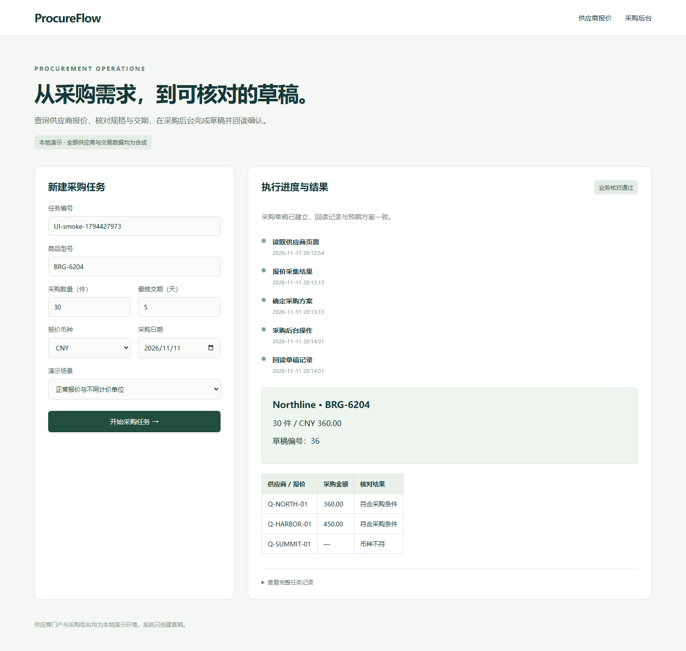
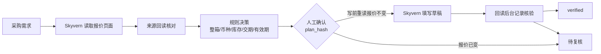

<!-- DOCTOC SKIP -->

# ProcureFlow · 报价采集与采购草稿核验 Agent

输入采购规格、数量和交期，Agent 用浏览器读取多家供应商报价，按业务规则选出可采购的报价，经人工确认后在采购后台填写草稿，最后回读后台记录核对结果。浏览器执行由 [Skyvern](https://github.com/Skyvern-AI/skyvern) 提供，采购领域逻辑、状态管理和评测在 [`procurement/`](procurement/)。



## 要解决的问题

浏览器 Agent 演示通常停在“点完了”。采购场景里还有三类问题：

- **模型选错报价。** 模型会选总价更低但不满足整箱、交期、币种或有效期约束的报价。
- **completed 不等于交付。** 上游任务指定 URL 时，传了抽取 schema 也可能没有抽取结果就结束。
- **写操作有副作用。** 保存后响应丢失、请求重复提交、确认期间供应商改价，都可能造成重复下单或按旧授权下新价格。

## 流程



| 模块 | 位置 | 作用 |
| --- | --- | --- |
| 报价口径与约束 | [`domain.py`](procurement/domain.py) | 用 `Decimal` 计算箱/件金额，校验币种、库存、交期、有效期，生成方案摘要 `plan_digest` |
| 业务状态 | [`store.py`](procurement/store.py) | 业务意图去重、冲突返回 409、确认门原子放行、重启后标记中断任务 |
| 编排与核验 | [`agent.py`](procurement/agent.py) | 采集、来源核对、写前重读报价、填写草稿、回读对账与恢复 |
| 服务与工作台 | [`server.py`](procurement/server.py)、[`web/`](procurement/web/) | 任务接口、确认接口、合成供应商门户与采购后台 |
| MCP Server | [`mcp_server.py`](procurement/mcp_server.py) | 把查报价、查任务、查草稿和发起采购暴露给任何支持 MCP 的 Agent；写入必须由人在工作台确认 |
| 测试与评测 | [`tests/`](procurement/tests/)、[`evaluation/`](procurement/evaluation/) | 无模型合同测试、真实模型任务、对照实验原始结果 |

## 验证结果

全部真实运行，逐任务记录保存在 [`procurement/evaluation/results/`](procurement/evaluation/results/)。

| 实验 | 结果 |
| --- | --- |
| 20 个保留任务，模型直接选报价 vs 业务规则选报价 | 19/20 vs 20/20 |
| 同样 20 题独立重复 4 次（pass^4） | 模型直接选报价 0.95（h03 四次全错）；业务规则 1.0 |
| 168 次真实作业的延迟与成本 | 均值 49.8s，p95 80.4s；写草稿时浏览器填写占 71% 耗时；约 0.011 美元/次（高峰价估算） |
| 推理强度 low 对照 high（[记录](procurement/evaluation/reasoning-effort.md)） | 准确率不变，推理 token 少 17%、成本少 6%；填写耗时一半在浏览器动作和页面处理，没有明显变快 |
| 在 3 个位置杀掉进程后恢复（写入授权启用后重跑，2026-11-22） | 3/3 恢复为已核验，每个单号恰好 1 张草稿 |
| 写入授权（运行中的工作台实测） | 不经确认提交 403；无审批口令或口令错误确认 401；没有对应任务直接写后台 403 |
| 三种实现在 4 个已知任务上的对照 | 直接调 API 4/4（均值 0.145s）；固定选择器 Playwright 3/4（2.496s，卡片布局超时）；Skyvern 4/4（66.004s） |
| 外部公开站点只读抽取（[books.toscrape.com](https://books.toscrape.com/)，对照实时 HTML） | 固定选择器 Playwright 0/2；Skyvern 2/2（均值 18.148s） |
| 16 个等价重复请求 | 全部复用原任务，事件数和草稿编号不变；需求冲突返回 409 |
| 保存成功但返回 503 | 恢复时先查后台已有草稿并对账，不重复填写 |
| 合同与 HTTP 集成测试 | 44 项通过（含 3 项 MCP、2 项并发） |

19/20 的那一题（h03）：要求采购 25 件，模型选了每箱 10 件、更便宜的报价，等于买 2.5 箱。规则把它标为 `fractional_pack`，改选按件报价。结论只覆盖这 20 个合成变体，不代表通用准确率。

对照实验的结论：目标系统有完整 API 时应该直接调 API；浏览器 Agent 的价值在于页面结构变化时无需写专用选择器，速度不占优。

## 作为 MCP 工具使用

[`mcp_server.py`](procurement/mcp_server.py) 通过 stdio 提供 MCP 工具，调用的是上面同一套任务接口。权限由运维方用 `PROCUREFLOW_MCP_MODE` 选择：

| 模式 | 工具 | 说明 |
| --- | --- | --- |
| `readonly`（默认） | `list_offers`、`get_purchase`、`get_draft` | 只读，标注 `readOnlyHint` |
| `propose` | 以上 + `propose_purchase` | 发起采购时强制写前确认和规则选报价，任务停在待确认，返回给人看的确认链接 |

所有模式都没有确认工具，Agent 不能批准自己发起的写入。采购单号是幂等键：相同请求返回同一任务，同一单号换了参数会被拒绝。

## 写入授权

只靠 MCP 不给确认工具还不够：同一台机器上的 Agent 可以直接调工作台 HTTP 接口。所以授权在服务端的三处检查：

| 位置 | 规则 |
| --- | --- |
| `POST /api/jobs` | 必须 `confirm_before_write=true`，否则 403 |
| `POST /api/jobs/{reference}/confirm` | 需要 `Authorization: Bearer <审批口令>`，口令在 `PROCUREMENT_APPROVER_TOKENS`（`姓名=口令`）中配置，未配置时确认功能关闭（503）；确认人记录在任务结果和事件里 |
| 采购后台 `POST /purchasing` | 同一事务内检查：该单号的任务正在写草稿，草稿字段的摘要等于任务计划摘要，且等于人确认过的摘要；任一不满足 403 |

第三条让浏览器 Agent 填错字段、确认后计划被改、任务已结束后补写，都在后台写入边界被拒绝，不再只依赖事后回读发现。模型直选和无 Agent 基线需要不经确认写入，只能在显式评测模式 `PROCUREMENT_ALLOW_UNCONFIRMED_WRITES=1` 下运行；这个模式也不会放行要求确认却未确认的任务。

并发方面有两项测试：16 个线程同时确认同一计划只成功 1 次、只记 1 条确认事件；16 个线程同时写同一草稿只插入 1 条。这是单机 SQLite 事务（`BEGIN IMMEDIATE`）下的正确性，不是吞吐或多实例结果。

真实验证（[`scripts/mcp_agent_e2e.py`](scripts/mcp_agent_e2e.py)，结果 [`mcp-e2e.json`](procurement/evaluation/mcp-e2e.json)）：DeepSeek 通过 stdio 拿到工具后，自己调用 `propose_purchase` 和 `get_purchase`，回答“方案已准备好，需要人确认，我不能自己确认”，并说明北线报价因为不能整箱凑出 25 件被排除。确认前后台没有草稿；人工确认后核验通过，草稿 1 张；重复提交复用原任务，换数量被拒绝。7 项检查全部通过。

接入 MCP 客户端的配置示例：

```json
{"mcpServers": {"procureflow": {
  "command": "python", "args": ["-m", "procurement.mcp_server"],
  "cwd": "<仓库目录>", "env": {"PROCUREFLOW_MCP_MODE": "propose"}}}}
```

需要 `mcp` Python 包（开发时 1.30.0）。

## 本地运行

需要 Docker Desktop 和一个支持图片输入的模型接口（开发时使用 DeepSeek）。密钥只放在本地配置文件。

```powershell
python scripts/configure_procurement.py --model-config <本地模型配置文件>
./scripts/start-procurement.ps1
```

工作台 <http://127.0.0.1:8091/>，Skyvern 健康检查 <http://127.0.0.1:8020/api/v1/heartbeat>。

无模型测试：

```powershell
python -m pytest -c procurement/tests/pytest.ini procurement/tests -q
```

完整说明、评测命令和实验细节见 [PROCUREMENT.md](PROCUREMENT.md)。

## 局限

- 供应商门户和采购后台都是合成环境，没有接入真实企业系统。
- 单进程 SQLite，两个任务槽；中断任务需要人工触发恢复，崩溃测试只覆盖单机。
- 业务流程是固定的“采集—决策—确认—写入—核验”，不是通用规划框架。
- 成本按公开价格和 token 计数估算，未与账单核对。
- 审批口令是本地演示用的静态共享口令，没有接入企业登录、角色或口令轮换；能读到口令配置的进程等同于审批人。

## 许可与上游

基于 Skyvern 提交 `26d2722b0fc9c7f3246389bdf7385ef18862b242` 构建，遵循 [AGPL-3.0](LICENSE)。Skyvern 原始说明见 [UPSTREAM_README.md](UPSTREAM_README.md)。
